# pi-model-banner

A [Pi](https://pi.dev) extension that replaces the generic Pi header with a vendor- and model-specific banner, which includes:

- The vendor's logo in its brand colors
- Model name, vendor and provider
- Every thinking level of the model, highlighting the selected one

The banner updates live when you switch models or thinking levels. On narrow terminals the logo steps aside and the details stay.

## Install

```bash
pi install npm:pi-model-banner      # Install.
pi -e npm:pi-model-banner           # Try without installing.
pi remove npm:pi-model-banner       # Uninstall.
```

From git: `pi install git:github.com/lennart-luttmann/pi-model-banner`.

## Thinking levels

For reasoning models the banner lists every thinking level the model supports and marks the active one. It also shows the hotkey used for cycling between them, if it exists.

```text
Thinking: [off]· minimal · low · medium · high · xhigh · max  (shift+tab)
```

```text
Thinking:  off · minimal · low ·[medium]· high · xhigh · max  (shift+tab)
```

```text
Thinking:  off · minimal · low · medium · high · xhigh ·[max] (shift+tab)
```

If the selected model does not support different reasoning levels, this line is omitted.

## Configuration

The default configuration should cover most providers and vendors. If your specific provider/vendor combination does not work properly or simply shows the default Pi logo, create or edit `~/.pi/agent/model-banner.json`:

```json
{
    "enabled": true,
    "overrides": {
        "<provider>/<model>": "<family id>"
    }
}
```

- `enabled` — set to `false` to keep Pi's own header.
- `overrides` — pick the logo for a model yourself. Map a model id, or
- `provider/model`, to a family id from [Vendors](#vendors).

Changes apply on the next start or after `/reload`. A mistake in the file never
stops Pi from starting. The banner warns about it and skips what it cannot use.

## Commands

| Command | Effect |
|---|---|
| `/banner` | Toggle between Pi's default header and the model banner. |
| `/banner on` / `/banner off` | Explicitly turn the banner on or off. |
| `/banner status` | Show whether the banner is on, which logo it uses and the path of the config file it uses. |

## Troubleshooting

| Symptom | Fix |
|---|---|
| Boxes instead of dots | Your terminal font does not include Unicode Braille characters. |
| Colors look off | Your terminal has no 24-bit color support, so the brand colors are approximated. |
| No logo at all | Use `/banner status` to check whether the banner is enabled and `/banner on` to enable it. If that does not work, your terminal could be too narrow. Try growing your terminal emulator window or decreasing your font size. |

Should other errors occur or these troubleshooting steps fail, feel free to open a [GitHub issue](https://github.com/lennart-luttmann/pi-model-banner/issues).

## Versioning

The first number of a version is the year: `26.x.x` releases come out in 2026, and
`27.0.0` will be the first release of 2027. The second number counts feature
releases, the third bugfixes. See [CHANGELOG.md](CHANGELOG.md) for what changed.

Working on the extension itself? See
[CONTRIBUTING.md](https://github.com/lennart-luttmann/pi-model-banner/blob/main/CONTRIBUTING.md).

## Trademarks

Logos are trademarks of their respective owners; this project is not affiliated
with or endorsed by any of them. Sources and licenses are listed in
[NOTICE.md](NOTICE.md).

## Vendors

Vendors are normally inferred from the id of the model in use, regardless of provider. The provider is only used if the model id doesn't point at a recognized vendor. The following list includes all covered vendors and the keywords they are recognized by.

**Your vendor of choice isn't covered?** Feel free to open an [issue](https://github.com/lennart-luttmann/pi-model-banner/issues) or a pull request with your own implementation. For more information read [CONTRIBUTING.md](https://github.com/lennart-luttmann/pi-model-banner/blob/main/CONTRIBUTING.md).

#### Anthropic

- **Models:** Claude
- **Recognized by:** `claude`
- **Providers:** `anthropic`, `claude`
- **Family id:** `anthropic`

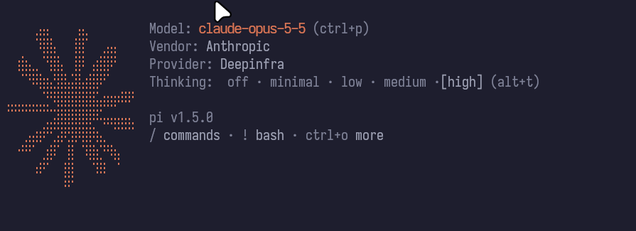

#### OpenAI

- **Models:** GPT, o-series, Codex
- **Recognized by:** `gpt`, `codex`, `chatgpt`, `o1`…`o9`
- **Providers:** `openai`, `azure`
- **Family id:** `openai`

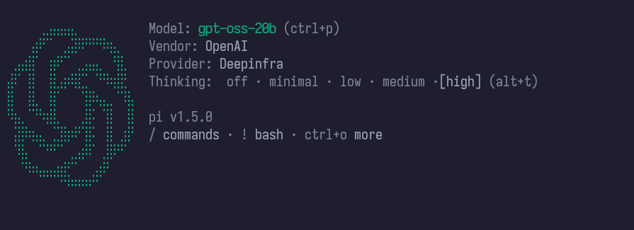

#### Google

- **Models:** Gemini, Gemma
- **Recognized by:** `gemini`, `gemma`
- **Providers:** `google`, `vertex`, `gemini`
- **Family id:** `google`

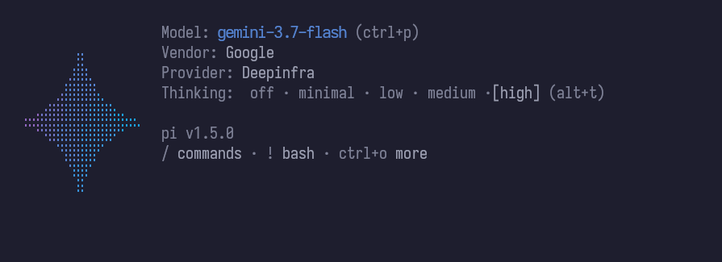

#### Mistral

- **Models:** Mistral, Codestral, Devstral, Magistral
- **Recognized by:** `mistral`, `codestral`, `devstral`, `magistral`
- **Providers:** `mistral`
- **Family id:** `mistral`

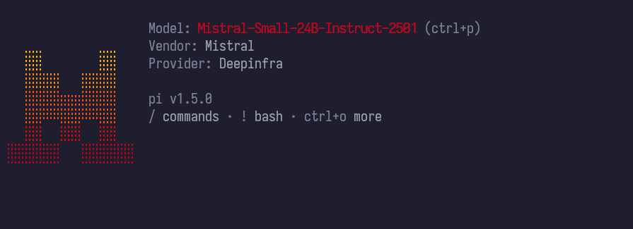

#### xAI

- **Models:** Grok
- **Recognized by:** `grok`
- **Providers:** `xai`, `x-ai`
- **Family id:** `xai`

**No screenshot available**

#### DeepSeek

- **Models:** DeepSeek
- **Recognized by:** `deepseek`
- **Providers:** `deepseek`
- **Family id:** `deepseek`

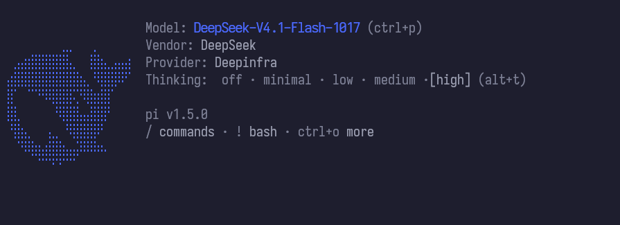

#### Qwen

- **Models:** Qwen
- **Recognized by:** `qwen`
- **Providers:** `qwen`, `dashscope`, `alibaba`
- **Family id:** `qwen`

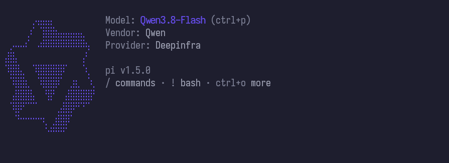

#### Moonshot

- **Models:** Kimi
- **Recognized by:** `kimi`, `moonshot`
- **Providers:** `moonshot`, `kimi`
- **Family id:** `moonshot`

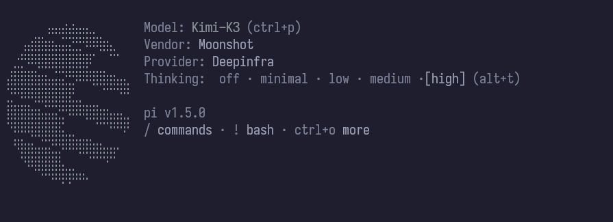

#### Z.ai

- **Models:** GLM
- **Recognized by:** `glm`
- **Providers:** `zai`, `z-ai`, `zhipu`
- **Family id:** `zai`

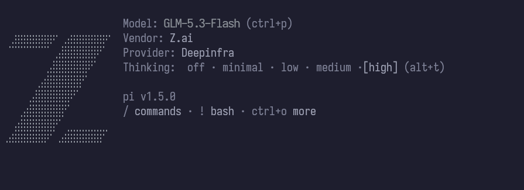

#### MiniMax

- **Models:** MiniMax
- **Recognized by:** `minimax`
- **Providers:** `minimax`
- **Family id:** `minimax`

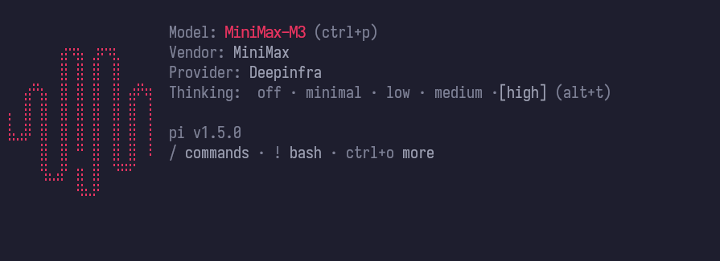

#### Meta

- **Models:** Llama
- **Recognized by:** `llama`
- **Providers:** `meta`, `llama`
- **Family id:** `meta`

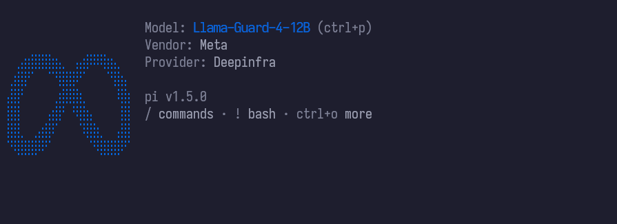

#### Fallback: Pi logo

- **Models:** everything not listed above
- **Vendor shown as:** Unknown
- **Family id:** `default`

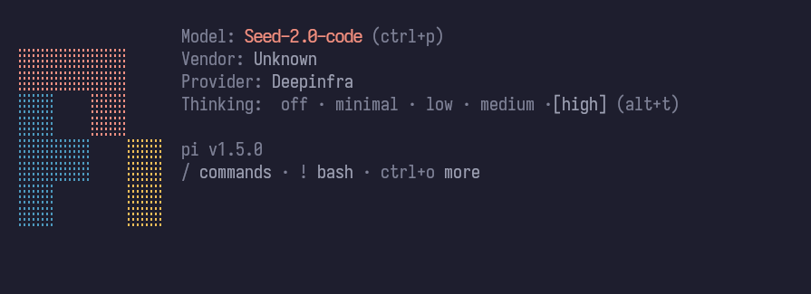

---

*This project was developed and tested on Pi 1.5.0.*
